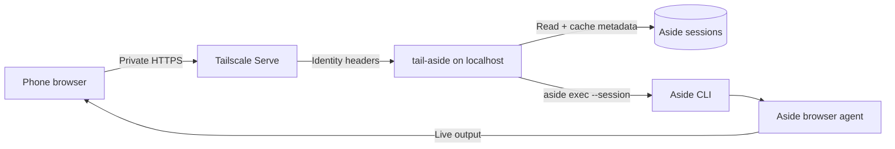

<p align="center">
  
</p>

<h1 align="center">tail-aside</h1>

<p align="center">
  <strong>Leave Aside on your Mac. Pick up the same agent session on your phone.</strong>
</p>

<p align="center">
  A private, mobile-first control surface for the Aside browser agent,<br>
  powered by the Aside CLI and Tailscale Serve.
</p>

<p align="center">
  <a href="https://github.com/quino0627/tail-aside/actions/workflows/ci.yml"></a>
  <a href="https://github.com/quino0627/tail-aside/releases"></a>
  <a href="LICENSE"></a>
  
</p>

<p align="center">
  <a href="#quick-start">Quick start</a> ·
  <a href="#how-it-works">How it works</a> ·
  <a href="#security-by-default">Security</a> ·
  <a href="https://github.com/quino0627/tail-aside/issues">Issues</a>
</p>

<p align="center">
  
</p>

<p align="center">
  <sub>One conversation, continued from a mobile viewport — live work, model controls, and all.</sub>
</p>

> [!IMPORTANT]
> `tail-aside` is an unofficial community project. It is not affiliated with or endorsed by Aside or Tailscale. Install and sign in to the Aside CLI separately.

## Your agent, without the desk

`tail-aside` does not replace Aside or run another agent in the cloud. It keeps the agent runtime on your Mac and gives your phone a private remote over your Tailnet.

<table>
  <tr>
    <td width="33%" valign="top">
      <strong>📱 Built for thumbs</strong><br><br>
      An installable mobile web app with responsive navigation, iPhone-safe inputs, and selectable output.
    </td>
    <td width="33%" valign="top">
      <strong>↩️ Continue, don't restart</strong><br><br>
      Pick an existing local Aside conversation and keep talking through <code>aside exec --session</code>.
    </td>
    <td width="33%" valign="top">
      <strong>🔒 Private by default</strong><br><br>
      The server stays on localhost. Tailscale Serve provides private HTTPS and verified Tailnet identity.
    </td>
  </tr>
</table>

## What you get

| Capability | What it means |
| --- | --- |
| **Real session continuity** | Search cached local sessions, open one, and send every follow-up back to that session. |
| **Live agent work** | Follow the response as it arrives and expand the work timeline when you want the details. |
| **Run controls** | Choose the model, speed, and reasoning effort for each message. |
| **Mobile-first PWA** | Add it to your Home Screen for a focused, app-like window. |
| **Guarded external sends** | Sending outside the agent requires an exact target, exact message, `SEND`, and explicit confirmation. |
| **Low-maintenance setup** | One command builds the app, installs a user LaunchAgent, and configures one Tailscale Serve route. |

## Quick start

> [!NOTE]
> You need macOS, Node.js 22.12+, a signed-in Aside CLI, and Tailscale connected on both your Mac and phone.

```bash
git clone https://github.com/quino0627/tail-aside.git
cd tail-aside
npm install
npm run setup
```

Setup detects your Aside account and current Tailscale login, builds the frontend, installs a per-user macOS LaunchAgent, and exposes port `4180` through Tailscale Serve. It then prints the private Tailnet URL to open on your phone.

In mobile Safari, choose **Share → Add to Home Screen** for the app-like experience.

Check the installation at any time:

```bash
npm run doctor
```

## How it works



When you send a follow-up, `tail-aside` preserves the selected session ID and invokes the CLI with that session. The conversation shown on your phone and the one stored by Aside remain the same thread.

### Stack

| Layer | Technology |
| --- | --- |
| Mobile UI | React 19, Vite 8, installable PWA |
| Local service | Node.js 22 with a small HTTP API |
| Session index | Built-in `node:sqlite` metadata cache |
| Private network | Tailscale Serve over HTTPS |
| Agent runtime | Your existing Aside CLI and browser agent |

## Security by default

This app controls a browser agent on your computer, so it should be treated as a privileged remote—not a public website.

- The server accepts only loopback listener addresses such as `127.0.0.1`.
- Tailscale Serve terminates private HTTPS and forwards verified identity headers.
- Setup allowlists the current Tailscale login unless you explicitly allow the whole Tailnet.
- State-changing requests require JSON, same-origin browser context, and the `X-Tail-Aside` marker.
- The content security policy blocks third-party scripts, framing, and remote connections.
- Session transcripts and cache files remain on the host; the browser stores only non-secret UI preferences.

> [!WARNING]
> Do not use **Tailscale Funnel** for `tail-aside`. Funnel publishes a service to the public internet.

For a shared Tailnet, review the official [Tailscale Serve documentation](https://tailscale.com/docs/features/tailscale-serve) and [grants documentation](https://tailscale.com/docs/features/access-control/grants). Report vulnerabilities through [GitHub private vulnerability reporting](https://github.com/quino0627/tail-aside/security/advisories/new).

## Configuration

<details>
<summary><strong>Setup options</strong></summary>

```text
--port <number>               Use another local and Tailnet HTTPS port
--no-launchd                  Configure and build without installing a service
--no-serve                    Do not change Tailscale Serve
--allow-any-tailnet-user      Allow every authenticated user in the Tailnet
--force-serve                 Replace an existing mapping on this exact port
```

The setup script refuses to replace an unrelated Serve mapping unless `--force-serve` is explicit. It never resets your other Tailscale Serve routes.

</details>

<details>
<summary><strong>Manual installation</strong></summary>

The one-command service setup targets macOS. Manual startup works anywhere the Aside CLI runs.

Copy [`config.example.json`](config.example.json) to `~/.config/tail-aside/config.json`, update the paths and login, then run:

```bash
npm install
npm run build
npm start
```

In another terminal:

```bash
tailscale serve --bg --https=4180 http://127.0.0.1:4180
```

</details>

<details>
<summary><strong>Environment variables</strong></summary>

Environment variables override the JSON configuration file.

| Variable | Purpose |
| --- | --- |
| `TAIL_ASIDE_CONFIG` | Alternate config file path |
| `TAIL_ASIDE_HOST` | Listener host; only loopback values are accepted |
| `TAIL_ASIDE_PORT` | Local HTTP port |
| `TAIL_ASIDE_BIN` | Aside executable path |
| `TAIL_ASIDE_ACCOUNT` | Aside account such as `u0` |
| `TAIL_ASIDE_SESSION_DIR` | Aside session directory |
| `TAIL_ASIDE_STATE_DIR` | Private cache and state directory |
| `TAIL_ASIDE_ALLOWED_LOGINS` | Comma-separated Tailscale login allowlist |
| `TAIL_ASIDE_ALLOW_ANY_TAILNET_USER=1` | Allow any authenticated Tailnet member |

</details>

## Development

```bash
npm run dev
npm test
npm run check
```

The production Node server serves `dist/`. Tests cover account detection, Tailnet authorization, write-request guards, run validation, CLI argument construction, and a live local API smoke test.

Focused issues and pull requests are welcome. Please run `npm run check` before opening a PR.

## Current scope

`tail-aside` is deliberately small and personal:

- It supports one user and one active agent run at a time.
- Aside CLI installation, authentication, browser capabilities, and model availability remain managed by Aside.
- Local session formats can change when the Aside CLI changes.
- It is not a hosted service, multi-tenant console, or official Aside mobile app.
- Tailscale Serve configuration remains machine-local and is never committed to this repository.

## License

MIT © 2026 MongWook Song. See [LICENSE](LICENSE) and [THIRD_PARTY_NOTICES.md](THIRD_PARTY_NOTICES.md).

The initial interaction research referenced the MIT-licensed [aside-telegram-bridge](https://github.com/SaiAmartya/aside-telegram-bridge). `tail-aside` uses its own name, icon, component code, and responsive layout.
