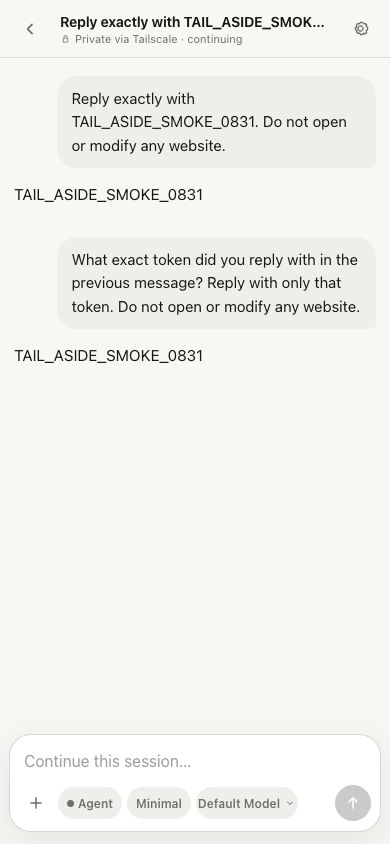
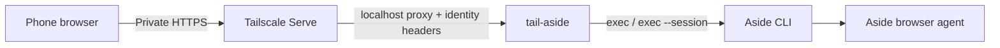

# tail-aside

Use the Aside browser agent from your phone over your private Tailscale network.

`tail-aside` is a standalone, mobile-first web app that runs beside the Aside CLI. It imports your local Aside session list, shows live agent work, and continues a selected conversation with `aside exec --session` instead of creating a new chat for every message.

<p align="center">
  
</p>

> [!IMPORTANT]
> This is an unofficial community project. It is not affiliated with or endorsed by Aside or Tailscale. You must install and sign in to the Aside CLI separately.

## What it does

- Lists and searches existing local Aside sessions, with an SQLite metadata cache.
- Continues the same Aside session across follow-up messages.
- Shows agent output and a collapsible live-work timeline.
- Lets you select model, speed, and reasoning effort per run.
- Works as an installable mobile web app with iPhone-safe input sizing and text selection.
- Keeps the server on localhost and exposes it only through Tailscale Serve.
- Restricts API access to the Tailscale login detected during setup by default.
- Requires an exact target, exact message, `SEND`, and a checkbox for any external-send request.



## Requirements

- macOS for the one-command LaunchAgent setup. Manual server startup also works anywhere the Aside CLI runs.
- Node.js 22.12 or newer. The session cache uses the built-in `node:sqlite` module.
- A working, signed-in Aside CLI.
- Tailscale connected on the host Mac and your phone.

## Quick start

```bash
git clone https://github.com/quino0627/tail-aside.git
cd tail-aside
npm install
npm run setup
```

The setup command:

1. Detects the Aside CLI and its signed-in account.
2. Detects your current Tailscale login and writes it as the only allowed user.
3. Builds the frontend.
4. Installs a per-user macOS LaunchAgent.
5. Creates a Tailscale Serve HTTPS mapping on port `4180`.

It prints the private Tailnet URL to open on your phone. In mobile Safari, use **Share → Add to Home Screen** for an app-like window.

Verify the installation at any time:

```bash
npm run doctor
```

### Setup options

```text
--port <number>               Use another local and Tailnet HTTPS port
--no-launchd                  Configure and build without installing a service
--no-serve                    Do not change Tailscale Serve
--allow-any-tailnet-user      Allow every authenticated user in the tailnet
--force-serve                 Replace an existing mapping on this exact port
```

The setup script refuses to replace an unrelated Serve mapping unless `--force-serve` is explicit. It never resets your other Tailscale Serve routes.

## Manual configuration

Copy [`config.example.json`](config.example.json) to `~/.config/tail-aside/config.json`, update the paths and login, then run:

```bash
npm install
npm run build
npm start
```

In another terminal:

```bash
tailscale serve --bg --https=4180 http://127.0.0.1:4180
```

Environment variables override the JSON file:

| Variable | Purpose |
| --- | --- |
| `TAIL_ASIDE_CONFIG` | Alternate config file path |
| `TAIL_ASIDE_HOST` | Listener host; only loopback values are accepted |
| `TAIL_ASIDE_PORT` | Local HTTP port |
| `TAIL_ASIDE_BIN` | Aside executable path |
| `TAIL_ASIDE_ACCOUNT` | Aside account such as `u0` |
| `TAIL_ASIDE_SESSION_DIR` | Aside session directory |
| `TAIL_ASIDE_STATE_DIR` | Private cache and state directory |
| `TAIL_ASIDE_ALLOWED_LOGINS` | Comma-separated Tailscale login allowlist |
| `TAIL_ASIDE_ALLOW_ANY_TAILNET_USER=1` | Allow any authenticated tailnet member |

## Security model

`tail-aside` intentionally listens only on `127.0.0.1`. Tailscale Serve terminates private HTTPS and forwards Tailscale identity headers; the API compares the forwarded login against its allowlist. Tailscale documents that Serve removes client-supplied copies of those identity headers before adding trusted values. Tailnet grants or ACLs provide an additional network-level boundary.

- Do not use Tailscale Funnel for this app. Funnel makes a service public on the internet.
- Keep `allowedLogins` narrow unless everyone in your tailnet should control the browser agent.
- The frontend stores only non-secret UI preferences. Session transcripts and cache files remain on the host.
- State-changing API calls require JSON, a same-origin browser context, and a `X-Tail-Aside` marker.
- The content security policy blocks third-party scripts, framing, and remote connections.

See the official [Tailscale Serve documentation](https://tailscale.com/docs/features/tailscale-serve) and [grants documentation](https://tailscale.com/docs/features/access-control/grants) when tightening access for a shared tailnet. Report vulnerabilities through [GitHub private vulnerability reporting](https://github.com/quino0627/tail-aside/security/advisories/new).

## Development

```bash
npm run dev
npm test
npm run check
```

The Node server serves `dist/` in production. Tests cover account detection, Tailnet authorization, write-request guards, run validation, CLI argument construction, and a live local API smoke test.

## Project boundaries

- Aside CLI installation, authentication, browser capabilities, and model availability are managed by Aside.
- Session formats are read from the local Aside data directory and may need updates when the CLI changes.
- `tail-aside` is single-user and allows one active run at a time. It is not a multi-tenant hosted service.
- Tailscale Serve configuration remains machine-local and is not committed to this repository.

## License and attribution

MIT © 2026 MongWook Song. See [LICENSE](LICENSE) and [THIRD_PARTY_NOTICES.md](THIRD_PARTY_NOTICES.md).

The initial interaction research referenced the MIT-licensed [aside-telegram-bridge](https://github.com/SaiAmartya/aside-telegram-bridge). `tail-aside` uses its own name, icon, component code, and responsive layout.
